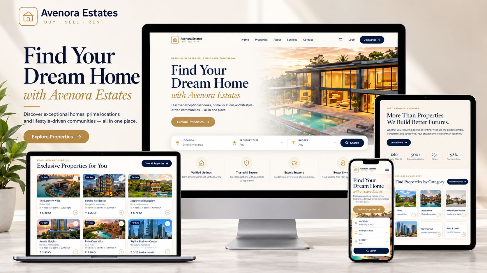

# Avenora Estates

> **BUY · SELL · RENT**



Avenora Estates is a premium real-estate web application built to provide a clean, modern, and responsive experience for discovering and exploring properties.

The project includes property browsing, detailed property information, favorites, authentication, user profiles, contact/inquiry functionality, and responsive layouts for mobile, tablet, and desktop.

---

## ✨ Features

- 🏠 Premium real-estate homepage
- 🔎 Property search and filtering
- 🏘️ Property listing and reusable property cards
- 📄 Detailed property pages
- ❤️ Favorite/save properties
- 🔐 Login and signup
- 🔑 Forgot and reset password flows
- 👤 User profile and account menu
- 📧 Contact and inquiry forms
- 🖼️ Property image galleries
- 🏷️ Property categories
- 📍 Property location information
- 🛏️ Bedrooms, bathrooms, area and other property details
- 📋 Amenities and floor-plan sections
- 🔗 Similar property recommendations
- 📱 Responsive mobile, tablet and desktop layouts

---

## 🛠️ Tech Stack

| Technology        | Purpose                       |
| ----------------- | ----------------------------- |
| React             | Frontend UI                   |
| TypeScript        | Type-safe development         |
| Vite              | Development and build tooling |
| Tailwind CSS      | Styling and responsive design |
| React Router DOM  | Client-side routing           |
| Lucide React      | UI icons                      |
| React Context API | Global application state      |
| Local Storage     | Client-side persistence       |

---

## 📂 Folder Structure

```text
avenora-estates-web/
│
├── public/
│   └── images/
│       └── Property and application images
│
├── src/
│   │
│   ├── app/
│   │   ├── App.tsx
│   │   ├── router.tsx
│   │   └── providers.tsx
│   │
│   ├── components/
│   │   ├── ui/
│   │   ├── layout/
│   │   └── shared/
│   │
│   ├── features/
│   │   ├── auth/
│   │   ├── favorites/
│   │   ├── properties/
│   │   ├── profile/
│   │   ├── contact/
│   │   └── services/
│   │
│   ├── pages/
│   │   ├── home/
│   │   ├── properties/
│   │   ├── property-details/
│   │   ├── about/
│   │   ├── services/
│   │   ├── contact/
│   │   ├── favorites/
│   │   ├── auth/
│   │   ├── profile/
│   │   └── legal/
│   │
│   ├── hooks/
│   ├── services/
│   │   ├── storage/
│   │   └── http/
│   ├── types/
│   ├── utils/
│   ├── constants/
│   ├── data/
│   ├── styles/
│   └── main.tsx
│
├── docs/
│   └── avenora-estates-preview.png
│
├── package.json
├── tsconfig.json
├── vite.config.ts
└── README.md
```

---

## 🧩 Main Folders

### `src/app/`

Application-level configuration such as the main app, routing, and providers.

### `src/components/`

Reusable UI, layout, and shared components such as the Navbar, Footer, Logo, buttons, cards, and account dropdown.

### `src/features/`

Feature-specific functionality organized by business area:

- `auth/` — authentication functionality
- `favorites/` — saved property functionality
- `properties/` — property-related functionality
- `profile/` — user profile functionality
- `contact/` — contact and inquiry functionality
- `services/` — service-related functionality

### `src/pages/`

Route-level page components that compose the application's features.

### `src/services/`

Application services and infrastructure-related logic such as storage and HTTP utilities.

### `src/hooks/`

Reusable React hooks.

### `src/types/`

Shared TypeScript types and interfaces.

### `src/utils/`

Reusable utility functions.

### `src/data/`

Static/demo data used by the current frontend implementation.

### `public/images/`

Local images and property assets used by the application.

---

## 📄 Main Routes

| Page             | Route              |
| ---------------- | ------------------ |
| Home             | `/`                |
| Properties       | `/properties`      |
| Property Details | `/property/:id`    |
| About            | `/about`           |
| Services         | `/services`        |
| Contact          | `/contact`         |
| Favorites        | `/favorites`       |
| Login            | `/login`           |
| Signup           | `/signup`          |
| Forgot Password  | `/forgot-password` |
| Reset Password   | `/reset-password`  |
| Profile          | `/profile`         |
| Terms            | `/terms`           |
| Privacy          | `/privacy`         |

---

## ❤️ Favorites

Users can save properties using the heart button.

Favorites are shared across the relevant property components and the Favorites page, with client-side persistence.

---

## 🔐 Authentication

The application includes:

- Login
- Signup
- Logout
- Forgot Password
- Reset Password
- Profile
- Account menu

The current frontend uses the project's client-side authentication/storage implementation.

---

## 📱 Responsive Design

Avenora Estates is designed for:

- Mobile
- Tablet
- Laptop
- Desktop
- Large desktop screens

The layout adapts navigation, property grids, forms, cards, galleries, and page sections to different screen sizes.

---

## 🎨 Design

The interface uses a premium real-estate visual style built around:

- Warm cream backgrounds
- Deep navy typography
- Gold/champagne accents
- White cards
- Subtle borders
- Soft shadows
- Elegant typography
- Minimal line icons
- Spacious layouts

The goal is to provide a professional and trustworthy property-discovery experience.

---

## 🚀 Getting Started

### Prerequisites

- Node.js
- npm

### Install dependencies

```bash
npm install
```

### Start development server

```bash
npm run dev
```

### Build for production

```bash
npm run build
```

### Run lint

```bash
npm run lint
```

### Preview production build

```bash
npm run preview
```

---

## 📦 Available Scripts

| Command           | Description                              |
| ----------------- | ---------------------------------------- |
| `npm run dev`     | Start the Vite development server        |
| `npm run build`   | Type-check and create a production build |
| `npm run lint`    | Run Oxlint                               |
| `npm run preview` | Preview the production build             |

---

## 🔮 Future Improvements

Possible future improvements include:

- Production backend API
- Database integration
- Secure server-side authentication
- Agent accounts
- Property management
- Property image uploads
- Advanced filtering and pagination
- Map integration
- Inquiry management
- Role-based access
- Production deployment

---

## 👨‍💻 Developer

**Naved Developer**

A developer-focused portfolio project demonstrating modern React development, responsive UI implementation, feature-based architecture, and real-estate product design.

---

## 📄 License

This project is a portfolio/project implementation by Naved Developer.
